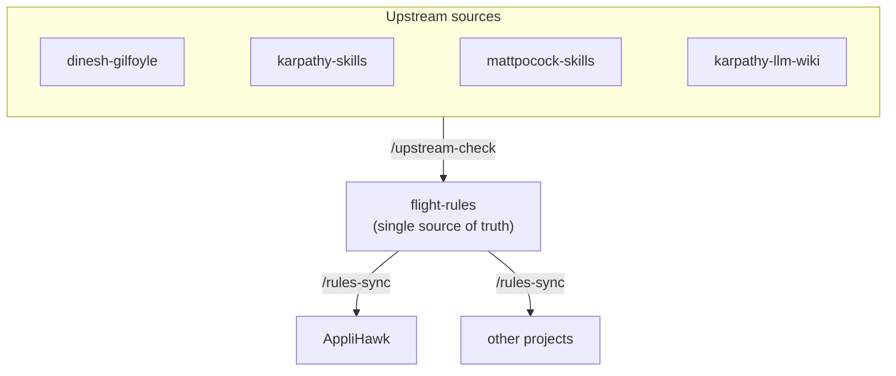

# flight-rules

[](.claude-plugin/plugin.json)
[](LICENSE)

Generic, project-agnostic engineering rules and AI workflows, distilled from real
projects (first: [AppliHawk](https://applihawk.com)). One source of truth — projects
consume this repo instead of maintaining drifting copies.

The name is borrowed from NASA's *flight rules* — the accumulated, written-down
procedures for every situation a mission has already encountered, so nobody improvises
a known problem twice.

Everything here is **plain Markdown and tool-agnostic**: the same files work with
Claude Code, Codex, Copilot, Antigravity, or any assistant that reads Markdown
context. A thin Claude Code plugin wrapper is included so Claude installs the skills
natively.

See [CHANGELOG.md](CHANGELOG.md) for what changes between versions.

> **What the hooks are for.** They catch the slip, not someone who means to get past
> them: [What these hooks are — and are not](hooks/README.md#what-these-hooks-are--and-are-not).
> What flight-rules is for, and what it holds to, is [MISSION.md](MISSION.md).

## How it flows

One hub, two directions. Improvements from the sources this playbook adapts flow **in**
(reviewed via `/upstream-check`); the playbook flows **out** to every project (pulled and
reconciled via `/rules-sync`) — so nobody maintains a drifting copy.



## Layout

```
MISSION.md What flight-rules is for — the questions every change to it answers
rules/     Always-on principles a project's CLAUDE.md / AGENTS.md should point at
skills/    Invocable workflows — see the catalog below
hooks/     Enforcement templates — git merge-gate hooks + agent commit/secret guards
.claude-plugin/   Claude Code marketplace + plugin manifests
UPSTREAMS.md      Sources this playbook adapts from + last-synced refs (see /upstream-check)
```

The skills say what the workflow is; the hooks make it non-optional: `hooks/git/`
gates merges into protected branches and refuses a commit that stages a key,
`hooks/agent/` stops the assistant committing,
destroying or force-pushing a protected branch, or committing secrets. The agent guard
ships with the plugin; the git hooks are copied in once per clone. Both read
`.ai/flight-rules.conf` — see `hooks/README.md`. This repo runs those hooks on itself,
straight from `hooks/` with no copy in between, so the rules repo obeys its own rules
and cannot drift from them (CI runs the hook suites on macOS and Linux).

## Rules

Always-on principles a project's rules entry point points at.

| Rule | Governs |
|---|---|
| [`engineering-principles`](rules/engineering-principles.md) | How to approach a change — scope discipline, verify before claiming done, suggest better ways, judge ideas on merit not authorship |
| [`git-worktree-workflow`](rules/git-worktree-workflow.md) | One change per branch via worktrees; never commit to a protected branch |
| [`multi-ai-setup`](rules/multi-ai-setup.md) | Conventions for running more than one AI assistant in a repo |

## Skills

Invocable workflows. In Claude Code they're slash commands; in any other tool they read as plain Markdown procedures.

| Skill | Does | Reach for it when |
|---|---|---|
| [`/dg`](skills/dg/SKILL.md) | Adversarial review — one persona defends, one tears it apart | Pressure-testing code, a design, or a decision |
| [`/diagnose`](skills/diagnose/SKILL.md) | Structured debugging — reproduce, minimise, fix, verify | A bug you can't one-shot |
| [`/feature-start`](skills/feature-start/SKILL.md) | Open a new branch as an isolated git worktree | Starting any unit of work |
| [`/pre-merge-check`](skills/pre-merge-check/SKILL.md) | Automated pre-merge checklist — tests, secrets, docs-match-the-change, and more; stamps a git note the merge-gate verifies | Before merging a branch |
| [`/pr-create`](skills/pr-create/SKILL.md) | Push the branch and open a GitHub PR with the checklist in the body | Ready to raise a PR |
| [`/commit`](skills/commit/SKILL.md) | Guarded commit — protected-branch, secret-scan, and test-coverage checks | Every commit |
| [`/docs-lint`](skills/docs-lint/SKILL.md) | Health-check living docs for drift, contradictions, and stale claims | Docs start to rot |
| [`/rules-sync`](skills/rules-sync/SKILL.md) | Pull the latest playbook and reconcile a project's local copies | After the playbook updates |

Maintaining flight-rules itself, `/upstream-check` checks the sources in `UPSTREAMS.md` for
changes to fold in. It lives in this repo's `.claude/skills/` and does not ship.

## Consuming from a project

**Claude Code (skills, native):**
```
/plugin marketplace add mkb3nigma/flight-rules     # or the local clone path
/plugin install flight-rules@flight-rules
```

Then start a new session in the project. The first one shows a `flight-rules doctor`
message with the command that installs the git hooks (the merge gate and the secret
scan) into `.ai/hooks/`; run it and commit `.ai/hooks/`. A plugin cannot do this step
itself: the hooks are the project's own committed files, and Claude Code has no install
event for a plugin to act on. Every other clone needs them wired once, because git config is
per clone: its first session's doctor message prints the command (the plugin's
`install.sh`, which wires the committed hooks without replacing them). (The message needs `jq` or
`python3`; without either, doctor's findings reach only the assistant.) A hook in the
install folder that isn't flight-rules' (no marker, no release's exact copy) is refused,
not overwritten, and the install says how to set it aside; flight-rules' own copies are
updated. It also names any hook git would stop running (`hooks/README.md` → `install.sh`). Running them alongside flight-rules' is
[#111](https://github.com/mkb3nigma/flight-rules/issues/111).

**Updating:** `/plugin` → update, then start a new session — the session-start checks run
only when one starts. After `/reload-plugins` instead, your next prompt says the session
is on the new version and that a new session is what loads its rules and runs the checks. If a git hook is behind the new release, that session's doctor
message prints the sync command with `--stale-only`: it replaces only copies identical
to an older release, and leaves a hook you changed alone and names it. To have the sync run on its own,
set `HOOK_SYNC=auto` in `.ai/flight-rules.conf` (see [Parameters](#parameters)). Each
release's
[CHANGELOG](CHANGELOG.md) entry starts with anything the update needs from you.

**Codex and Antigravity (skills and principles, by plugin):** both install this plugin as
it is, from a clone: `codex plugin marketplace add <clone>` then `codex plugin add
flight-rules@flight-rules`, or `agy plugin install <clone>`. Both get the skills.
Antigravity also loads `engineering-principles.md` into every session; Codex runs no
plugin hooks, so add the rules pointer below to the project's `AGENTS.md`. Neither runs
flight-rules' agent hooks, so no doctor reminds you to wire the git hooks — the merge
gate and the secret scan. Do it yourself: the first time in a project,
`bash <plugin>/hooks/git/install.sh --from <plugin>/hooks/git` and commit `.ai/hooks/`;
in every other clone, `bash .ai/hooks/install.sh`; after a plugin update, the first command again
(not `--stale-only`, which knows only Claude Code's plugin cache), and commit. `<plugin>` is
`~/.codex/plugins/cache/flight-rules/flight-rules/<version>` or
`~/.gemini/config/plugins/flight-rules`.

**Any AI tool (rules, by pointer):** add one line to the project's rules entry point
(CLAUDE.md, AGENTS.md, `.ai/master-rules.md`, …):

> Generic engineering rules: read `~/Projects/flight-rules/rules/` (or the repo URL).
> Project rules extend and override them.

**Or just point your assistant at it.** No clone, plugin, or marketplace required — give
your assistant the repo link and ask it to incorporate the rules, or point your project's
rules file at the URL. The Claude Code plugin is a convenience wrapper, not a dependency;
a native plugin for other assistants (Copilot, …) can follow if there's demand.
However you adopt it, keep the attribution — the MIT licence simply asks that the
copyright and licence notice travel with the content ([LICENSE](LICENSE),
[ATTRIBUTIONS.md](ATTRIBUTIONS.md)).

## Project-specific extensions

Never edit these files with project details. **Generic changes flow here; project
flavor stays in the project** — a skill's deltas in `.ai/skills/<name>/EXTENSIONS.md`,
the pattern [`multi-ai-setup`](rules/multi-ai-setup.md) principle 4 describes.

## Parameters

Skills refer to placeholders rather than hardcoding a project's setup. The branch
policy has **one home, `.ai/flight-rules.conf`**, the file the hooks read —
`PROTECTED_BRANCHES`, `PR_ONLY_BRANCHES`, `NOTE_GATED_BRANCHES`, `INTEGRATION_BRANCH`,
`WORKTREE_DIR`, `MERGE_NEEDS_INSTRUCTION` — so the skills and the enforcement never disagree about which
branches are protected. The rest lives in the skill's `EXTENSIONS.md`. The conf's other
settings — the hook sync, the open-branch limit, `/dg`'s — are in the
[Configuration table](hooks/README.md#configuration).

| Placeholder | Meaning | Example | Home |
|---|---|---|---|
| `{PROTECTED_BRANCHES}` | branches that never take direct commits (regex) | `^(main\|staging\|dev)$` | conf |
| `{PR_ONLY_BRANCHES}` | branches that move only through a reviewed PR — no local merges | `^main$` | conf |
| `{NOTE_GATED_BRANCHES}` | branches a merge into which needs a passing pre-merge-check note | `^(dev\|staging)$` | conf |
| `{INTEGRATION_BRANCH}` | where feature branches merge | `dev` | conf |
| `{WORKTREE_DIR}` | where feature worktrees live | `.ai/worktrees` | conf |
| `{TEST_COMMANDS}` | the project's suites | `pytest` / `npm run test:run` | `EXTENSIONS.md` |
| `{PLAYBOOK_PATH}`, `{LOCAL_RULES_DIRS}` | where `/rules-sync` finds the playbook and the project's local copies | `~/Projects/flight-rules`, `.ai/rules/` | `EXTENSIONS.md` |

## Credits & license

MIT for original content (see `LICENSE`). Several pieces adapt other people's work and
carry their upstream licenses — notably the `dg` skill (from
[v1r3n/dinesh-gilfoyle](https://github.com/v1r3n/dinesh-gilfoyle), Apache-2.0) and the
engineering principles (from
[multica-ai/andrej-karpathy-skills](https://github.com/multica-ai/andrej-karpathy-skills),
MIT, after Andrej Karpathy's observations).

Provenance is tracked as a system, not a footnote: every adaptation is credited with its
modifications in [ATTRIBUTIONS.md](ATTRIBUTIONS.md), and each source's last-reviewed ref
is pinned in [UPSTREAMS.md](UPSTREAMS.md) so `/upstream-check` can tell when an upstream
has moved and something is worth folding back in.
